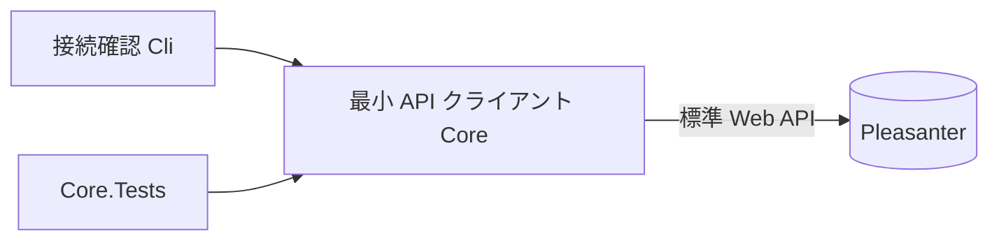

# アーキテクチャ方針

## 目的と現在地

RSS 2.0 / Atom 1.0 を取得し、記事を Pleasanter の列へ対応づけてレコードを作成・更新する。
Pleasanter 本体を取り込まず、標準 Web API を利用する別アプリとして作る。
ライセンスは AGPL-3.0-or-later 単独。

現在は初期化段階。取り込み機能は未実装であり、設計メモのレビュー後に実装する。
既存の Core は最小の API クライアント、Cli は接続確認だけを持つ。
単体テストはスタブ通信のみで、実機の Pleasanter による動作は未確認。

## 現在の構成

## 次に設計すること

取得・正規化・重複排除・対応づけ・作成／更新の責務と設定を設計する。
HTTP 条件付き取得、ID、本文・日時・カテゴリ・添付、冪等性、Core.Data の再利用、
API の版差・再試行・秘密管理・テストを検討する。
管理画面・スケジューラ・Docker 化とメール受信は今回の範囲外。

## 未決事項

- 解析ライブラリ、RSS 1.0/RDF・JSON Feed の扱い
- 外部キー列と状態保存方式、競合・更新規則、対応づけの設定仕様
- CLA を要求しない方針の承認と、貢献者の権利確認・DCO 等の追加要否
- Pleasanter 1.5 系以降の互換性。実機は未確認
