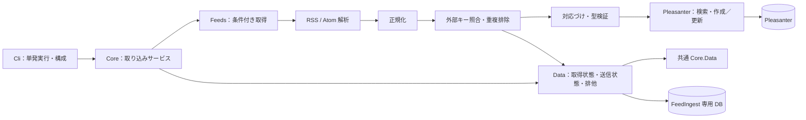
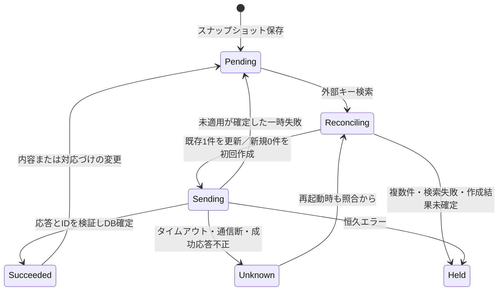

# アーキテクチャ方針

## 1. 目的・現在地

FeedIngest は RSS / Atom を取得し、記事を列へ対応づけて、
Pleasanter の標準 Web API でレコードを作成・更新する別アプリ。
「出す」側は `…Feed`、「入れる」側は `…Ingest` とする。
メール受信は別ツール MailIngest の責務であり、本リポジトリには実装しない。

**Issue #1 の設計を基に、U1〜U12 は2026-10-22にユーザー承認で確定した。**
Issue #3 は12章の1〜3までを実装する。取り込み機能は未実装。
Core の正規化モデル・設定検証・秘密参照と、分離した Pleasanter の最小 API、
既存 check がある。Feeds は依存を固定する空のプロジェクトのみ。
Data・HTTP取得・解析・対応づけ実行・取り込みサービス・本実行CLIは次の作業とする。

| 区分 | 内容 |
| --- | --- |
| 第2段階の対象 | RSS 2.0 / Atom 1.0、HTTP 取得、正規化、重複排除、対応づけ、作成／更新 |
| 次の段階 | 管理画面、スケジューラ、Docker、分散実行、添付バイナリ取り込み |
| 当面対象外の推奨 | RSS 1.0/RDF、RSS 0.9x、JSON Feed、HTML からのフィード自動発見 |
| 非目標 | 記事全文のクローリング、サイト自動作成、既存レコードの自動削除、メール受信 |

RSS 1.0/RDF・JSON Feed を必要とする実例が出たら、独立した解析アダプターを追加する。
RSS 2.0 のフィードから消えた記事は削除と解釈しない。フィードは全履歴とは限らない。

## 2. 提案構成と依存の向き

名前空間の接頭辞は `VehicleVision.PleasanterTools.FeedIngest`。
この製品の `.Core`（ドメイン）と、別製品の共通部品 `PleasanterTools.Core.*` は別物。

| プロジェクト | 責務・参照 |
| --- | --- |
| `.Core` | 正規化モデル、外部キー、決定的な対応づけ、取り込みサービス、各ポート |
| `.Feeds` | HTTP 取得、RSS/Atom 解析、フィード項目から正規化モデルへの変換。Core を参照 |
| `.Pleasanter` | API 認証、検索、列の型・JSON 変換、作成／更新、応答分類。Core を参照 |
| `.Data` | 取得状態、取り込み状態、排他、マイグレーション。Core と共通 Core.Data を参照 |
| `.Cli` | 設定、秘密の解決、DI、単発実行、終了コード。各層を組み立てる |
| 各層の `.Tests` | 純粋関数、フェイク通信、使う DB への結合テスト |

Issue #3 で `.Core` 内の API クライアントと接続設定・既存テストを `.Pleasanter` へ移した。
接続確認 CLI のコマンドと旧環境変数を維持する。
ドメインは HTTP・DB・Syndication・Pleasanter の列名に依存させない。
ポートは取得、状態ストア、送信先、時刻／待機の最小限に限定する。
MailIngest との共通新パッケージを先回りして作らない。

管理画面やスケジューラを後から足すときは、CLI と同じ取り込みサービスを呼ぶ。
今回は常駐ワーカーや Web ホストを作らない。1 回取得して終了する CLI とする。

### 共通 Core の再利用

[開発ガイド](開発ガイド.md) と Core のコア化方針を確認済み（[参照情報](設計の参照情報.md)）。
接続解決・暗号化検査・`DbTime`・マイグレーション・SQL 方言差は新しく書かない。

- `.Data` に `FeedIngestDatabase` を1つ置き、`AppDatabase("feedingest", migrationAssembly)` を保持
- 既定 DB は SQLite。`App_Data/feedingest.db` と `FEEDINGEST_DB_*` は AppDatabase が導く
- マイグレーションは Data のアセンブリに置き、アプリ番号は `M0001` から追加のみ
- Core の共有マイグレーションは Core に任せ、既存番号の変更・共有ストアの再実装をしない
- 日時列はネイティブ日時型、書込は `DbTime.ForDb`、読込は `DbTime.AsUtc`
- Core が持つ Dapper・FluentMigrator・DB ドライバを直接依存として重複宣言しない
- Core.Mail は SMTP 等の送信、Core.Web は Web／本人確認用。今回の用途では参照しない

**重要：Core.Data 自体は寛容ライセンスではなく AGPL／商用のデュアル提供。**
公開版 `0.1.0-preview.11` と許諾を確認した。FeedIngest は AGPL 側で使う（U2確定）。
2026-10-22の時点では、これは本製品を商用デュアルにする意味ではなかった。寛容ライセンスを基本とする依存規約の例外として、
同日のユーザー承認で例外を確定した。
2026-10-28 に利用者の方針で本製品自体がデュアルへ改まったため、商用側を選ぶ利用者は
Core の商用ライセンスも必要になる（Core の著作権者は同じ ITソリューション事業部。条件は法務確認中）。
Data は次の作業のため、今回は PackageReference・ロックファイルに追加していない。
Core.Mail も今回追加しない。

## 3. HTTP 取得・解析

以下はU9で承認した初期既定値。起動時に範囲を検証する。
Issue #3 は設定値の検証まで。通信時の上限適用・再試行は後続作業で実装する。
解析ライブラリに URL を直接渡さず、アプリ管理の HttpClient で取得したバイト列を渡す。

| 項目 | 推奨仕様 |
| --- | --- |
| 形式 | RSS 2.0 と Atom 1.0 のルート・名前空間を検証。他形式は明示エラー |
| 通信 | HTTPS のみ。TLS 検証を無効化しない。URL の userinfo・fragment は拒否 |
| タイムアウト | 1 要求30秒（本文読取を含む）、1 取り込み元の取得全体120秒 |
| リダイレクト | 自動追従しない。最大5回、各 hop の URI・宛先を再検証 |
| 別 origin | 既定拒否。明示許可先でも資格情報・任意ヘッダを引き継がない |
| 容量 | 圧縮前後とも10 MiB、記事1万件、記事本文1 MiB を上限とする |
| XML | DTD 禁止、XmlResolver 無効、文字数上限。外部実体・外部文書を取得しない |
| 再試行 | GET の通信断・408・429・5xx のみ、初回＋最大3回、全体時間内 |

同一 origin は scheme・host・port の組。HTTPS から HTTP への降格は常に拒否する。
任意 URL を入力できる将来の管理画面にも備え、loopback・link-local・プライベート宛は既定拒否。
社内フィードは管理者が host／port とネットワーク範囲を明示許可する（U11）。
DNS 再解決・IPv6・リダイレクトで制限を回避できない接続先検査を第2段階で実装・テストする。
OS の egress 制限も併用する。Pleasanter 側は明示した接続先だけへ送り、リダイレクトを拒否する。

### 認証

取り込み元ごとに `none` / `basic` / `headers` のいずれかを指定する。
Basic の user/password、ヘッダ値は秘密参照だけにし、平文 HTTP へ送らない。
`Authorization` を含むヘッダ認証も許すが、Host・Cookie・Content-Length・接続制御、
条件付き取得ヘッダ等の上書きは拒否する。複数の認証方式の混在、CR/LF のある値は設定エラー。
Cookie の自動保存・OS の既定資格情報は使わない。資格情報を添付 URL へ転送しない。

### 条件付き取得と取りこぼしの防止

成功した表現の ETag は引用符・弱いタグも含めて保存し、`If-None-Match` で送る。
Last-Modified があれば `If-Modified-Since` も送る。両方あるときの優先は HTTP 仕様に従う。
キャッシュは sourceId・有効 URL・認証設定の版で区切り、別の取り込み元と共有しない。
秘密そのものをキャッシュキーへ入れない。URL／認証変更時は検証子を無効化する。

**200 を受けただけで ETag を進めない。**
本文全体のサイズ・形式・正規化を検証し、処理対象の不変スナップショットを DB に積み、
取得バッチと検証子を同一トランザクションで確定してから進める。
保存に失敗したら旧検証子を維持し、次回200で取り直す。
途中の XML 解析失敗・件数超過時はバッチを部分確定しない。

304 は「取得表現に変更なし」であり、未送信項目の成功ではない。
毎回、HTTP 取得とは独立して DB の Pending／Unknown を処理する。
送信失敗した記事がフィードから消えても、保存済みスナップショットから再開する。
304 のとき本文を解析せず、既存バッチなしの304は検証子を捨てて再取得する。
新しい200に ETag／Last-Modified が無ければ古い値を消す。
マッピング変更時は304でも保存済み正規化項目を新設定で再評価する。

### 文字コード

`ReadAsStringAsync` の既定解釈に依存しない。HTTP charset・BOM・XML 宣言を検査する。
RFC 7303 §3 を根拠とし、BOM があればそれを優先、無ければ明示 charset、
それも無ければ XML の判定規則（宣言・UTF-8 等）で復号する。
相互矛盾・未知の charset・不正バイトは置換文字で続けず、Encoding エラーで止める。
第2段階は UTF-8／UTF-16 を必須とし、RSS の Shift_JIS／EUC-JP は
`System.Text.Encoding.CodePages` 候補で試験する。具体的な追加範囲は未決事項。

## 4. 正規化する記事

モデルは `SourceId / NativeId / IdentityKind / Link / Title / Summary / Content /
ContentKind / PublishedAt / UpdatedAt / Categories / Authors / Enclosures` を持つ。
未設定日時を現在時刻や `DateTime.MinValue` へ黙って置換しない。

| 項目 | RSS 2.0 | Atom 1.0 |
| --- | --- | --- |
| 第一識別子 | item/guid（不透明文字列として扱う） | entry/id（不変 ID） |
| ID がない場合 | 有効な絶対 link。どちらも無ければ項目エラー | id 必須。不在は項目エラー |
| link | item/link | rel=alternate、HTML 優先。無指定 rel は alternate |
| 公開日 | pubDate | published（任意） |
| 更新日 | 標準項目はないため null | updated（必須） |
| 本文 | content:encoded を明示対応、なければ description | inline content、なければ summary |
| カテゴリ | category の値＋domain を配列で保持 | category の term・scheme・label を保持 |
| 添付 | enclosure の url・type・length | rel=enclosure の href・type・length |

`content:encoded` は RSS 2.0 本体ではない拡張のため、その名前空間を限定して試験する。
未知の拡張は自動マッピングしない。将来必要な項目だけ明示して取り込む。
Atom の外部 `content src`、非テキストの base64 本文は取得・展開しない。URL 等のメタデータのみ。
相対 URI は `xml:base` と最終取得 URL を根拠に解決する。記事 link の変更で guid/id は変えない。
同一フィード内で同じ ID・同じ内容は1件にまとめ、同じ ID・異なる内容は競合として保留する。

内部日時は `DateTimeOffset?` とし UTC の同一時刻へ正規化する。オフセット欠落・不正日は項目エラー。
RSS の更新判定は日時ではなく内容ハッシュで行う。未来日付だけで項目を捨てない。
HTML は未信頼データ。本文内画像・スクリプト・URL の取得や実行はしない。
初回は HTML をテキスト化して Body へ送る（U4確定）。
HTML の生保存・サニタイズ方式は今回の対象外とする。
単純な正規表現だけで HTML を除去／安全化しない。採用パーサーも実装前にライセンス確認する。

enclosure は第2段階ではメタデータの JSON／URL を Description 列に対応づける。
バイナリ取得・Base64 アップロードは次段階。Attachments 列を指定したら「未対応」と設定エラーにする。
黙って捨てたり、URL を添付済みと報告したりしない。

## 5. 対応づけ設定

設定の形・JSON の完全な例・列別の規則は [対応づけ設定](対応づけ設定.md) に記載する。
1 source に1 siteId、固定値・既定値・元項目を列ごとに宣言する。
任意スクリプト・テンプレート式は初回非対応。予約した外部キー列と一般マッピングを混在させない。
型・文字数・必須値・未知項目を送信前に検証し、エラーがあればその記事全体を保留する。

## 6. 重複排除・状態保存・更新

### 保存方式の比較と推奨

| 案 | 利点 | 制約 |
| --- | --- | --- |
| Pleasanter の外部キー列だけ | 自前 DB 不要、利用者も照合できる | 毎回検索、未送信記事・ETag・排他を永続化しにくい |
| 自前 DB のみ | 一意制約、取得状態・再開・設定版を持てる | Create 成功後の通信断と DB 喪失を照合できない |
| **DB＋外部キー列（推奨）** | 再開と応答不明の照合を両立 | DB バックアップと専用列の確保が必要 |

SQLite を使う FeedIngest 専用 DB と、取り込み先の未使用 Class 列を1本予約する（U1）。
例は `ClassZ`。列の単一値・長さ・読取／検索／書込権限を事前検査する。
外部キー列が確保できなければ、堅牢な自動作成を有効にしない。
ユーザーが列を削除・編集すると安全な照合ができなくなるため、運用上の管理列とする。

### 外部キーと DB の最小状態

外部キーは `fi:v1:`＋SHA-256 小文字hex（64桁）。
ハッシュ入力は `["fi:v1", sourceId, identityKind, identity]` の UTF-8 の決定的な JSON 配列。
文字列の単純連結では境界衝突するため使わない。guid/id の大文字小文字・内部文字は変えない。
link を使う場合は絶対 URI の scheme/host と既定ポートだけ正規化し、query と path を保つ。
鍵には siteId を含めず、DB 上の送信先識別子と siteId で配送先を区切る。
sourceId は安定した不透明 ID。表示名やフィード URL の変更で変えない。
購読元ごとの重複排除であり、別 sourceId の同じ記事を横断して統合はしない。

| 状態 | 主な値 |
| --- | --- |
| Sources | SourceId、URL／認証設定版、ETag、LastModified、バッチ ID、取得時刻 |
| Entries | SourceId、外部キー、IdentityKind、元 ID、正規化 JSON、内容ハッシュ |
| Deliveries | 送信先 ID、SiteId、外部キー、ReferenceId、設定版、送信値ハッシュ、状態 |
| Attempts | 試行 ID、操作、結果分類、試行回数、次回時刻、照合保留理由 |

Deliveries の `(DestinationId, SiteId, ExternalKey)` に一意制約を置く。
DestinationId は接続先の安定 ID。BaseUrl／siteId の変更は移設扱いとし、暗黙に再作成しない。
Entries の未送信データを、新着の同 ID の値で上書きしない。
送信スナップショットに正規化内容・マッピング版・送信値を固定してから通信し、
新しい更新はその後の配送版として順番に処理する。
原文 XML の常時保存は不要。DB 内の本文や enclosure URL も秘密相当としてアクセス制限する。

### 1 記事の状態遷移

通信前に Sending と試行 ID を確定し、正常応答後に ID・送信値ハッシュを確定する。
プロセス停止で Sending が残った場合は Pending に単純に戻さず Unknown として扱う。
初回作成前と Unknown 復旧では外部キーを検索し、完全一致0件／1件／複数件を区別する。
1件ならその ID を記録し、保存内容を再照合して更新または完了にする。複数なら人が解決するまで保留。

**Unknown の検索が0件でも、元の要求が処理中なら後から作成され得る。**
初回＋最大3回（待機1/2/4秒案）で読み直し、それでも0件なら照合保留で終了する。
0件だけを根拠に Create を自動再送しない。運用者が元要求の未適用を確認してから明示再実行する。
待機の短さは安全性の根拠にしない。API に冪等キー／一意制約がない限り exactly-once は保証しない。

同一 DB を使う全 CLI の実行排他を開始時に取り、2本目は非ゼロで終了する。
第2段階は単一ホスト・単一プロセス実行のみ。実行中の排他が失われたら送信を停止する。
マイグレーション排他と取り込み実行排他は別物として実装する。
別 DB から同じ source/site へ送る運用、利用者の同時作成までは防げないため禁止・注意事項にする。
Pleasanter 側に原子的な一意キー保証がない前提で、Upsert を冪等性の代用にしない。

### 更新規則

- 同じ外部キーで、対応づけ後の値と設定版が同じなら送信しない
- 記事の updated が増えなくても内容の変化を検出する。古い更新日だけで削除・再作成しない
- 初回既定は upsert。createOnly は既存なら触らず、再取り込みで同じ記事を作らない
- upsert が所有するのは設定された列だけ。未対応列・利用者の他列は変更しない
- 利用者が所有列を編集した場合は、次回の送信対象変更時に取り込み値で上書きする（U5）
- 送信値が不変なら人の編集を毎回戻す同期監視はしない。強制再同期は明示操作
- 項目欠落は既定で列に触らない。空文字の明示値とは分ける（日付クリアは初回非対応）
- 記事の消滅や404で既存レコードを削除しない。RecordId が消えた場合も自動再作成せず保留
- 外部キー方式・予約列・送信先の変更は移行操作。DB 初期化だけで運用を再開しない

## 7. Pleasanter API

対象は1.5系以降を目標とする。ただし2026-10-22に確認したソースは **1.5.8.1 のみ**。
全1.5版／将来版の互換性は保証しない。実機での JSON・日時・権限・添付の挙動はすべて未確認。
以下のパス・フィールドの事実は [参照情報](設計の参照情報.md) に記録した SHA のソースで確認した。
参照ソースは Git で追跡せず、再調査前に `bash scripts/sync-reference.sh` で上流 `main` を取得する。
`PLEASANTER_REFERENCE_DIR` 指定時は取得先を直接読む。CI・ビルド・配布物へは含めない。
過去の根拠はそのまま残し、再確認した事実に完全な SHA・固定リンク・参照日を付ける。

| 用途 | POST パス／形 |
| --- | --- |
| 認証 | JSON 本体の `ApiKey` と数値 `ApiVersion: 1.1`。ヘッダ認証を前提にしない |
| サイト検査 | `api/items/{siteId}/GetSite`。サイトと必要列を検証、作成・変更しない |
| 外部キー検索 | `api/items/{siteId}/Get`。`View.ColumnFilterHash` で専用 Class 列を絞る |
| レコード確認 | `api/items/{referenceId}/Get`。SiteId と外部キーも再検査 |
| 作成 | `api/items/{siteId}/Create`。マッピング値と外部キーを同じ要求で保存 |
| 更新 | `api/items/{referenceId}/Update`。所有列だけ送る |

検索では `ColumnFilterSearchTypes` の完全一致（確認ソースの値は2）を指定する案。
値の配列の JSON 文字列化・フィルターの挙動は第2段階の契約試験で固定する。
部分一致や先頭1件だけを信用せず、返却された外部キーを序数比較で再検査し、
`Response.Offset / PageSize / TotalCount / Data` に従って全候補を調べる。
検索の権限不足・ページ欠落・不正JSONを「0件」と解釈しない。
成功は HTTP と JSON の StatusCode、作成 Id、必要な応答形を合わせて確認する。
API キー利用者は管理列と全取り込みレコードを読める専用アカウントにする。
レコード権限によって既存行が検索から隠れる運用では、0件が未作成の証拠にならない。
その構成を許可しない前提を運用手順へ記載し、権限変更後の再開前に照合を行う。

ApiVersion は製品の1.5とは別の値。接続単位で明示可能にし、未知の版へ自動フォールバックしない。
取り込み先は Results／Issues の両テーブルを想定するが、サイト種別を検査し、
応答 ID の `ResultId`／`IssueId` 等の違いは Pleasanter 層に閉じ込める。
拡張列・日時・件数上限・API キー利用者のタイムゾーンは版・サイト設定に依存する。
未対応を検出したら書き込まず、対応可否を診断する。

### 日時

内部 UTC を、そのまま API のローカル日時とみなして送らない。
Q は API キー利用者の TimeZone へ変換する実装を持つが、FeedIngest での実機確認ではない。
`apiKeyUserTimeZoneId` を明示し、.Pleasanter 内の変換1か所に閉じる。
サーバ／利用者のタイムゾーン変更後の再解釈、DST、未設定日クリア値は実装前の契約確認事項。
初回は日付の自動クリアを行わない。

### API 回数制限と再試行

低レベルクライアントは再試行しない。結果を分類し、取り込みサービスが操作別に判断する。
フィード用と Pleasanter 用の HttpClient／資格情報／再試行状態を分離する。
同時 API 要求は1、最低間隔250ms、実行予算1000要求を初期案とし、検索・照合も数える。
予算切れは未処理を DB に残し、非ゼロ終了。成功件数に含めない。

408・429・5xx で自動再試行可能な読み取りは、初回＋最大3回。
待機は1/2/4秒の指数バックオフ＋0〜1秒ジッター。
Retry-After は秒／HTTP-date の両方を解釈し、その時刻より前には送らない。
60秒を超える待機指定は切り詰めて再送せず、次回時刻を保存して今回は終了する。
ヘッダなし429には既定待機を使うが、日次等の API 割当超過を短い再試行で解消できると仮定しない。

書き込みの5xx・408・通信断は、適用済みの可能性があるため Unknown として先に照合する。
429も経路の応答だけでは未適用と断定せず、Create の再送前は同じ照合を行う。
更新は同じ所有列値の再送に限定し、追加コメントや添付追加など非冪等な操作を混ぜない。
更新完了も確認できなければ保留し、無限再送しない。
401はこの単発 CLI では停止、403・404・検証エラーは設定／権限エラーとして保留する。
Q の常駐ワーカーの「401も自動再送」という運用は、そのまま採用しない。

## 8. 設定・エラー・ログ

設定ファイルは秘密値を含まない JSON。CLI は `--config` で明示したファイルを読み、
`FEEDINGEST_*` の環境変数で接続等を上書きする案。秘密は env 名を JSON から参照する。
既存 `check` の `PLEASANTER_*` は維持し、両名前空間が競合したら起動エラーにする。
環境変数の平文値と `_FILE` が両方存在したら優先せずエラーにする（Q の規則に合わせる）。

`_FILE` は絶対パス、最大64 KiB、末尾の改行1組のみ除去、空・不在・読取不能はエラー。
キー名以外の秘密内容・ファイル内容を例外へ載せない。ファイルの ACL を利用者が制限する。
Issue #3 の `SecretReference` は env／_FILE を解決し、改行を含む認証値を拒否する。
ファイルは厳格なUTF-8（BOM可）とし、例外に値・パス・元例外を含めない。
Q の SecretFileConfigurationProvider は設計参照のみで、Web 層全体を依存に持ち込まない。
共通 Core はData／Mail／Web用であり、今回の秘密参照のためには導入しない。
JSON の検証はライブラリ API として提供し、`check` に `--config` を追加するのは後続作業。

| 分類 | 例 | 扱い |
| --- | --- | --- |
| Configuration | 未知項目、列重複、秘密参照不在 | 起動前に拒否、終了コード2 |
| Authentication / Authorization | Feed／Pleasanter の401・403 | 取り込み元を停止、終了コード1 |
| Transport / RateLimit | GET の一時通信失敗、429 | 有限再試行／次回へ。未完了なら1 |
| Parse / Encoding | XML／文字コード不正、未対応形式 | バッチ未確定、理由を記録、1 |
| Item / Mapping | ID 不在、型・長さ超過 | 項目保留、他の正常項目は続行、1 |
| Unknown / Conflict | 書込結果不明、外部キー複数 | 照合・保留、盲目的な新規作成禁止、1 |
| Storage | DB 不可、排他取得失敗 | 書込前に停止、1 |
| Cancellation | 利用者の中断 | 送信中は Unknown として保存、終了コード130案 |

終了0は全対象成功または変更なしのみ。取り込み元別の created/updated/unchanged/held/failed を出す。
構造化ログは実行 ID、sourceId、試行 ID、分類、HTTP status、件数、所要時間だけを基本とする。
API キー・Basic・任意ヘッダ、要求／応答本体、記事本文、元 ID、URL query、
接続文字列、秘密ファイル内容は記録しない。例外メッセージの無加工出力も禁止する。
ログ出力用 DTO を用意し、設定全体や HttpClient の詳細トレースを出さない。
フィード URL が query に認証値を要求する場合は今回拒否し、ヘッダ方式等を使う。

## 9. テスト方針と未確認の境界

**テストを外部サーバーや実機 Pleasanter に当てない。**
Q の xUnit・StubHandler・列別の組み立て試験を参考にする。
Q の実機テストの成功や、そのソースにある資格情報を流用しない。

| 対象 | 必須の試験 |
| --- | --- |
| フィード解析 | RSS／Atom、各ID・日時・本文・カテゴリ・複数 enclosure、拡張・相対URI |
| 入力拒否 | RDF／JSON、DTD、外部実体、未知 charset、不正日時、同ID競合、サイズ限界±1 |
| HTTP | 200→304、ETag／Last-Modified、charset、gzip上限、30秒タイムアウト、5 hop上限 |
| 認証・宛先 | Basic／ヘッダ、別origin漏えいなし、降格拒否、DNS／IPv6／内部宛先制限 |
| 対応づけ | 固定／既定／欠落／空、未知列、型・長さ、予約列、設定版変更、HTML未実行 |
| API | パス、ApiKeyの本体配置、ApiVersion、全ページ検索、Id／StatusCode／不正JSON |
| 冪等性 | 同記事2回でCreate1回、更新1回、異なるsource、応答消失後の照合、複数一致 |
| 障害復旧 | Sending中断、DB確定失敗、200保存前停止、304でも未送信再開、DB二重起動拒否 |
| 再試行 | 429の両Retry-After形式、割当超過、最大3回、予算上限、Unknown時にCreate再送なし |
| 秘密・終了 | env／_FILE競合、ファイル上限、ログ非露出、部分失敗で非ゼロ、中断 |

HttpMessageHandler と時刻・待機を差し替え、待機試験は実時間を待たない。
必要な HTTP 境界試験はプロセス内のフェイクサーバーのみ。
Data は一時 SQLite の実 DB を使い、固有 SQL・一意制約・トランザクション・実行排他を検証する。
他 RDBMS は採用した時点で、その DB のアプリ固有 SQL 試験を追加する。
Core の4 RDBMS基盤試験を複製しない。

第1段階のビルド・既存7テスト成功は、取り込み機能や実機 API の動作を保証しない。
Pleasanter の日時、列制約、フィルター、権限、版差、実ネットワークの文字コードは未確認。
第2段階のフェイク契約試験も実機互換性の証明ではないと明記する。

## 10. ライセンス整理

FeedIngest は当初 **AGPL-3.0-or-later 単独**とし、デュアル提供への切替手順・理由・リリース条件を削除した（2026-10-22）。
**2026-10-28 に利用者の方針で改め、AGPL-3.0-or-later と商用のデュアル（草案。法務の確認前。Issue #17）にした。**
`LICENSE`、npm の license、NOTICE、依存監査・参照隔離 CI は維持。PackageLicenseExpression は LicenseRef を扱えないため外した。
初期テンプレートに商用条件書・CLA・CLA ワークフロー／必須チェックは存在しなかった。
存在しないファイルを「削除した」とは扱わない。`LICENSE-COMMERCIAL.md` は 2026-10-28 に新設した。詳細は [ライセンス](ライセンス.md)。

U7 は同日の後続ユーザー指示「公開するリポジトリは CLA を足す」により更新する。
取り込み前に CLA への署名を求める。当初は将来のライセンス選択の余地を残すためで、AGPL 単独提供は変えない前提だった。
2026-10-28 のデュアル化で、CLA の再許諾は商用ライセンスを提供するために実際に使う。
追加のDCO運用は導入しない。
Core.Data の AGPL 側利用はU2で例外承認済み。商用側を選ぶ利用者は Core の商用ライセンスも必要（法務確認中）。DotNetClient（未公開LGPL）への依存は禁止。
Pleasanter 本体はデュアルでも引き続き参照専用で、ビルド・配布へ含めない。取り込むと商用側を提供できなくなる。

## 11. 確定事項・残るリスク

### 確定（2026-10-22 ユーザー承認）

U1〜U12 は以下のとおり確定した。U7 は同日の後続ユーザー指示による更新を反映する。
表の代替案／リスクは比較記録として残す。
確定は実機確認済み・全機能実装済みという意味ではない。

| ID | 論点・推奨案 | 代替案／残るリスク |
| --- | --- | --- |
| U1 | DB＋外部キー列、SQLite、単一ホスト | DBなしは運用が軽いが未送信保存と排他が弱い |
| U2 | Core.Data のAGPL側を例外承認（自社共通部品） | 次のData実装で採用版と推移依存を再確認 |
| U3 | Syndication採用、RSS2/Atom1に限定 | FeedReaderはRSS1も対応。現時点で必要性未確定 |
| U4 | HTMLはテキスト化、enclosureはメタデータのみ | 生HTMLは閲覧時の安全性、添付実体は容量・SSRF・再送問題 |
| U5 | 宣言的マッピングのみ、所有列は更新時上書き | テンプレート式、手修正保護・競合検出は別設計 |
| U6 | guid/id→link、source間は統合しない | IDなしの本文ハッシュは更新を別記事にしやすい |
| U7 | 公開リポジトリへの貢献は CLA 必須。（確定時は AGPL 単独提供を維持。2026-10-28 に利用者の方針でデュアルへ改めた） | 許諾権限の確認が必要 |
| U8 | Pleasanter 1.5以降、確認根拠は1.5.8.1 | 全版対応・日時・フィルター・列制約は実機未確認 |
| U9 | 本文10MiB等の上限・有限再送・保持期間 | 運用実測なし。バックアップ／保留解消の手順が必要 |
| U10 | UTF-8/16必須、旧日本語コードは追加候補 | CodePagesの要否・対象文字集合は実例で決める |
| U11 | 内部URLは明示許可、HTTPSのみ | 社内HTTPの必要性が出たら別途リスク評価する |
| U12 | 設定版の再評価、送信先変更は明示移行 | 全履歴を持たないフィードから過去記事を復元できない |

保持期間は、未完了／Unknown／Held を自動削除しないことを最低条件とする。
成功済み本文の保存期間と、重複排除用キーの保存期間は分ける。
キーを削除すると古い記事を再作成し得る。DB と Pleasanter のバックアップのずれも照合対象になる。
暗号化・バックアップ・DB喪失時の再照合・運用者の保留解消コマンドを第2段階で具体化する。

## 12. 第2段階の作業順序

1. U1〜U12 をレビューし、対象形式・マッピング・Core例外・HTML処理・保持の方針を確定
2. Core／API層を分離。正規化モデル、設定検証、秘密参照、既存check互換とテストを用意
3. 一次情報で採用版・推移依存を確認し、依存・NOTICE・ロックファイルを同時更新
4. Data に AppDatabase・取得バッチ・配送状態・実行排他・マイグレーションを実装
5. Feeds に制限付き HTTP・条件付き取得・解析・正規化とフェイク試験を実装
6. 決定的な対応づけと、Pleasanter の検索・型変換・作成／更新を契約試験と実装
7. Unknown照合・再開・予算・429待機・終了コードを含む取り込みサービスと単発CLIを接続
8. 障害注入・再実行・秘密非露出を検証し、利用者向け設定・バックアップ・保留解消手順を更新

管理画面・スケジューラ・Docker・メール受信・実機接続をこの作業へ暗黙に追加しない。
第2段階も Issue ごとに実装と検証結果を残し、未確認を動作済みと説明しない。
